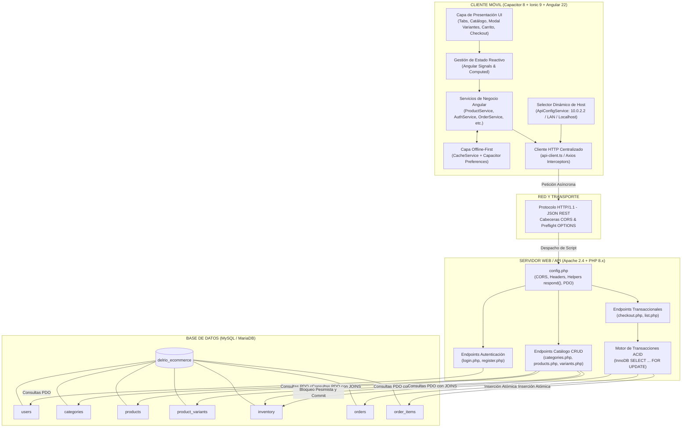

# UNIVERSIDAD POLITÉCNICA DE DURANGO
**Ingeniería en Software — 9° Cuatrimestre**  
**Materia:** Programación Móvil II (9B)  
**Unidad II:** Arquitectura Cliente-Servidor en los móviles  
**Actividad:** Diseño de arquitectura Cliente-Servidor  
**Proyecto:** E-Commerce Del Río Caps (Capacitor 8 + Ionic 9 + Angular 22 + PHP 8 + MySQL)

---

## 1. Diagrama de Arquitectura Cliente → API → Base de Datos

La solución implementa una **Arquitectura en Capas Desacoplada** orientada a dispositivos móviles híbridos (Android, iOS y Web PWA). El cliente móvil no se conecta directamente a la base de datos por razones de seguridad, latencia y consumo de batería; en su lugar, consume un servicio web RESTful mediante un cliente HTTP centralizado con caché local offline.



### Flujo de Datos
1. **Petición del Usuario:** El usuario interactúa con la vista en Ionic (ej. filtrar productos o realizar checkout).
2. **Intercepción y Caché:** El servicio Angular evalúa si existen datos en caché en `Capacitor Preferences` (`CacheService`). Si existen, los retorna de inmediato para renderizado instantáneo (patrón *Stale-While-Revalidate*).
3. **Resolución de Host:** `ApiConfigService` resuelve automáticamente la IP correspondiente:
   - En **Emulador Android**: traduce hacia `http://10.0.2.2:80/9b-api`.
   - En **Celular Físico**: utiliza la IP LAN de la computadora (ej. `http://192.168.1.103:80/9b-api`).
   - En **Navegador Web**: utiliza `http://localhost:80/9b-api`.
4. **Procesamiento en Servidor:** Apache recibe la petición, valida cabeceras CORS en `config.php`, enruta al script PHP correspondiente y ejecuta consultas preparadas vía `PDO`.
5. **Transaccionalidad en BD:** En operaciones de compra, MySQL ejecuta bloqueos de fila (`FOR UPDATE`) para evitar condiciones de carrera en el inventario antes de emitir la respuesta JSON estandarizada.

---

## 2. Lista de Endpoints Requeridos

| Módulo | Endpoint Relativo | Método | Parámetros / Body | Descripción | Códigos HTTP |
| :--- | :--- | :---: | :--- | :--- | :---: |
| **Auth** | `/login.php` | `POST` | Body: `{ email, password }` | Autentica al usuario y retorna datos de sesión. | `200`, `401`, `422`, `500` |
| **Auth** | `/register.php` | `POST` | Body: `{ first_name, last_name, email, password }` | Registra un nuevo cliente con password hasheado (`bcrypt`). | `201`, `409`, `422`, `500` |
| **Catálogo** | `/catalog/categories.php` | `GET` | Query opcional: `?id={id}` | Lista todas las categorías o consulta una por ID. | `200`, `404`, `500` |
| **Catálogo** | `/catalog/categories.php` | `POST` | Body: `{ name, slug, parent_id? }` | Crea una nueva categoría. | `201`, `422`, `500` |
| **Catálogo** | `/catalog/categories.php` | `PUT` | Query: `?id={id}`, Body parcial | Actualiza los datos de una categoría. | `200`, `404`, `422`, `500` |
| **Catálogo** | `/catalog/categories.php` | `DELETE` | Query: `?id={id}` | Elimina una categoría. | `200`, `404`, `500` |
| **Catálogo** | `/catalog/products.php` | `GET` | Query opcional: `?category_id={id}` o `?id={id}` | Obtiene catálogo completo o filtrado con cálculo de stock total. | `200`, `404`, `500` |
| **Catálogo** | `/catalog/products.php` | `POST` | Body: `{ category_id, sku_base, name, description, brand, base_price, image_url }` | Da de alta un nuevo producto. | `201`, `422`, `500` |
| **Catálogo** | `/catalog/products.php` | `PUT` | Query: `?id={id}`, Body parcial | Modifica datos del producto. | `200`, `404`, `422`, `500` |
| **Catálogo** | `/catalog/products.php` | `DELETE` | Query: `?id={id}` | Elimina un producto. | `200`, `404`, `500` |
| **Variantes** | `/catalog/variants.php` | `GET` | Query: `?product_id={id}` o `?id={id}` | Obtiene variantes (tallas, ml, colores, precios y stock real). | `200`, `404`, `500` |
| **Variantes** | `/catalog/variants.php` | `POST` | Body: `{ product_id, sku, size, color, volume_ml, price }` | Crea variante y crea automáticamente fila de inventario. | `201`, `422`, `500` |
| **Variantes** | `/catalog/variants.php` | `PUT` | Query: `?id={id}`, Body parcial | Actualiza variante. | `200`, `404`, `422`, `500` |
| **Variantes** | `/catalog/variants.php` | `DELETE` | Query: `?id={id}` | Elimina variante (cascada en inventario). | `200`, `404`, `500` |
| **Pedidos** | `/orders/checkout.php` | `POST` | Body: `{ user_id, delivery_type, payment_method, shipping_address, items: [{ variant_id, quantity }] }` | Transacción de compra con bloqueo pesimista y deducción atómica de inventario. | `201`, `409`, `422`, `500` |
| **Pedidos** | `/orders/list.php` | `GET` | Query: `?user_id={id}` | Historial de órdenes de compra del cliente con desglose de artículos. | `200`, `422`, `500` |

---

## 3. Métodos HTTP Utilizados

El diseño se apega a la semántica del protocolo HTTP/1.1 y principios RESTful:

### `GET` (Lectura / Idempotente y Seguro)
- **Uso:** Obtención de categorías, listado de productos, variantes y pedidos.
- **Seguridad:** No altera el estado del servidor ni de la base de datos.
- **Ejemplo:** `GET /catalog/products.php?category_id=4` retorna los tenis en formato JSON.

### `POST` (Creación / No Idempotente)
- **Uso:** Operaciones donde se envía un cuerpo JSON para registrar entidades nuevas o iniciar procesos de negocio: autenticación (`login.php`), registro de clientes (`register.php`) y checkout de compra (`checkout.php`).
- **Respuesta:** Retorna código `201 Created` con el objeto generado o `200 OK` en autenticación.

### `PUT` (Modificación Completa o Parcial / Idempotente)
- **Uso:** Actualización de atributos de categorías, productos o variantes existentes pasando el identificador en la query string (`?id=X`).
- **Respuesta:** Retorna código `200 OK` con el recurso actualizado.

### `DELETE` (Eliminación / Idempotente)
- **Uso:** Remoción física de registros del catálogo (`/catalog/products.php?id=X`).
- **Respuesta:** Retorna código `200 OK` confirmando la eliminación.

### `OPTIONS` (Preflight CORS / Negociación de Seguridad)
- **Uso:** Enviado automáticamente por el navegador o WebView de Capacitor antes de cualquier petición compleja (`POST`, `PUT`, `DELETE` con `Content-Type: application/json`).
- **Manejo:** El archivo compartido `config.php` detecta `$_SERVER['REQUEST_METHOD'] === 'OPTIONS'` y emite inmediatamente cabeceras de autorización con código `204 No Content`, evitando el bloqueo por la política *Same-Origin Policy*.

### Códigos de Estado HTTP Estandarizados
- `200 OK`: Consulta o actualización exitosa.
- `201 Created`: Recurso creado exitosamente (producto o pedido confirmado).
- `204 No Content`: Preflight CORS resuelto favorablemente.
- `400 Bad Request`: Petición malformada o sintaxis JSON inválida.
- `401 Unauthorized`: Credenciales erróneas o sesión no válida.
- `404 Not Found`: Recurso inexistente en la base de datos.
- `409 Conflict`: Conflicto de negocio (correo ya registrado o **stock insuficiente al momento de la compra**).
- `422 Unprocessable Entity`: Campos obligatorios faltantes o tipos de datos inválidos.
- `500 Internal Server Error`: Fallo no controlado de conexión a base de datos o excepción de PDO.

---

## 4. Modelo JSON de Intercambio de Información

Para asegurar uniformidad en todo el sistema, todas las respuestas de la API implementan un contrato tipado envolvente:

### 4.1. Contrato Genérico de Respuesta (`ApiResponse<T>`)
```typescript
export interface ApiResponse<T> {
  success: boolean;  // true si la operación fue exitosa, false si hubo error
  message: string;   // Mensaje descriptivo legible por el usuario
  data?: T;          // Carga útil de datos devueltos (opcional)
  user?: User;       // Utilizado en login/registro (opcional)
}
```

### 4.2. Ejemplos Reales de Intercambio JSON

#### Petición y Respuesta de Inicio de Sesión (`POST /login.php`)
**Petición enviada desde el móvil:**
```json
{
  "email": "demo@example.com",
  "password": "Password123!"
}
```

**Respuesta devuelta por el servidor (HTTP 200):**
```json
{
  "success": true,
  "message": "Bienvenido al sistema.",
  "user": {
    "id": 1,
    "first_name": "Alfredo",
    "last_name": "Del Río",
    "email": "demo@example.com"
  }
}
```

---

#### Consulta de Catálogo con Cálculo Dinámico de Inventario (`GET /catalog/products.php?category_id=4`)
**Respuesta devuelta por el servidor (HTTP 200):**
```json
{
  "success": true,
  "message": "OK",
  "data": [
    {
      "id": 1,
      "category_id": 4,
      "category_name": "Calzado",
      "sku_base": "NK-AF1-07",
      "name": "Nike Air Force 1 '07 Triple White",
      "description": "El ícono legendario del streetwear en piel genuina blanca, amortiguación Nike Air encapsulada.",
      "brand": "Nike",
      "base_price": "2499.00",
      "image_url": "https://images.unsplash.com/photo-1595950653106-6c9ebd614d3a?w=800",
      "active": 1,
      "total_stock": 63
    }
  ]
}
```

---

#### Consulta de Variantes y Stock Individual (`GET /catalog/variants.php?product_id=1`)
**Respuesta devuelta por el servidor (HTTP 200):**
```json
{
  "success": true,
  "message": "OK",
  "data": [
    {
      "id": 1,
      "product_id": 1,
      "sku": "NK-AF1-07-26",
      "size": "26 MX",
      "color": "Triple White",
      "volume_ml": null,
      "price": "2499.00",
      "active": 1,
      "stock": 12,
      "reserved": 0
    },
    {
      "id": 2,
      "product_id": 1,
      "sku": "NK-AF1-07-27",
      "size": "27 MX",
      "color": "Triple White",
      "volume_ml": null,
      "price": "2499.00",
      "active": 1,
      "stock": 18,
      "reserved": 0
    }
  ]
}
```

---

#### Transacción de Compra y Descuento de Stock (`POST /orders/checkout.php`)
**Petición enviada desde el checkout móvil:**
```json
{
  "user_id": 1,
  "delivery_type": "delivery",
  "payment_method": "card",
  "shipping_address": "Av. Universidad Politécnica #100, Durango, Dgo.",
  "recipient_name": "Alfredo Del Río",
  "recipient_phone": "6181234567",
  "notes": "Dejar en caseta de vigilancia",
  "items": [
    {
      "variant_id": 1,
      "quantity": 1,
      "unit_price": 2499.00
    }
  ]
}
```

**Respuesta confirmada del servidor (HTTP 201):**
```json
{
  "success": true,
  "message": "Pedido confirmado exitosamente.",
  "data": {
    "order_id": 14,
    "folio": "DRC-608291",
    "total": 2499.00,
    "status": "pending_payment"
  }
}
```

---

## 5. Servicio Angular Preparado para Consumir la API

En cumplimiento de las buenas prácticas de arquitectura de software, **no se utiliza `HttpClient` disperso ni llamadas `fetch()` sueltas** en los componentes. Toda la comunicación se centraliza a través de un cliente HTTP con interceptores de diagnóstico, selector dinámico de host y una capa de almacenamiento local offline.

### 5.1. Cliente HTTP Centralizado (`src/app/services/api-client.ts`)
```typescript
import axios, { AxiosInstance, AxiosError, InternalAxiosRequestConfig } from 'axios';
import { environment } from '../../environments/environment';

export const apiClient: AxiosInstance = axios.create({
  baseURL: environment.apiUrl,
  timeout: 10000,
  headers: {
    'Content-Type': 'application/json',
    Accept: 'application/json',
  },
});

// Interceptor de Peticiones: Trazabilidad y cabeceras de depuración
apiClient.interceptors.request.use(
  (config: InternalAxiosRequestConfig) => {
    config.headers['X-Client-Platform'] = 'Ionic-Angular-Mobile';
    config.headers['X-Request-Timestamp'] = new Date().toISOString();
    return config;
  },
  (error: AxiosError) => Promise.reject(error)
);

// Interceptor de Respuestas: Gestión centralizada de excepciones
apiClient.interceptors.response.use(
  (response) => response,
  (error: AxiosError) => {
    console.error(`[API Error] ${error.config?.method?.toUpperCase()} ${error.config?.url}:`, error.message);
    return Promise.reject(error);
  }
);
```

---

### 5.2. Selector Dinámico de Host para Móviles (`src/app/services/api-config.service.ts`)
Resuelve el problema clásico de desarrollo móvil donde `localhost` no funciona en dispositivos físicos ni en el emulador de Android:

```typescript
import { Injectable, signal } from '@angular/core';
import { Preferences } from '@capacitor/preferences';
import { Capacitor } from '@capacitor/core';
import { environment } from '../../environments/environment';
import { apiClient } from './api-client';

const CONNECTION_CONFIG_KEY = 'api_connection_config';
const API_FOLDER = '9b-api';

export interface ApiConnectionConfig {
  protocol: 'http' | 'https';
  ip: string;
  port: number;
}

@Injectable({ providedIn: 'root' })
export class ApiConfigService {
  public connectionConfig = signal<ApiConnectionConfig>(this.buildDefaultConfig());

  constructor() {
    this.applyConfig(this.connectionConfig());
    void this.loadConfig();
  }

  private buildDefaultConfig(): ApiConnectionConfig {
    // Si corre en emulador Android, se utiliza 10.0.2.2 para alcanzar el servidor de la PC
    if (Capacitor.getPlatform() === 'android') {
      return { protocol: 'http', ip: '10.0.2.2', port: 80 };
    }
    const match = environment.apiUrl.match(/^(https?):\/\/([^:/]+)(?::(\d+))?/);
    return {
      protocol: (match?.[1] as 'http' | 'https') ?? 'http',
      ip: match?.[2] ?? 'localhost',
      port: match?.[3] ? parseInt(match[3], 10) : 80,
    };
  }

  public applyConfig(config: ApiConnectionConfig): void {
    this.connectionConfig.set(config);
    apiClient.defaults.baseURL = `${config.protocol}://${config.ip}:${config.port}/${API_FOLDER}`;
  }

  public async setServerAddress(rawInput: string): Promise<void> {
    const clean = rawInput.trim();
    if (!clean) return;
    const [ip, portText] = clean.split(':');
    const config: ApiConnectionConfig = {
      protocol: 'http',
      ip,
      port: portText ? parseInt(portText, 10) : 80,
    };
    this.applyConfig(config);
    await Preferences.set({ key: CONNECTION_CONFIG_KEY, value: JSON.stringify(config) });
  }
}
```

---

### 5.3. Servicio de Negocio con Caché Offline-First (`src/app/services/product.service.ts`)
```typescript
import { Injectable, inject } from '@angular/core';
import { apiClient } from './api-client';
import { ApiResponse, Product, ProductsResult } from '../models/catalog.models';
import { CacheService } from './cache.service';
import { FALLBACK_PRODUCTS } from './fallback-catalog';

const CACHE_KEY_PREFIX = 'products_v2_cat_';

@Injectable({ providedIn: 'root' })
export class ProductService {
  private cache = inject(CacheService);
  private readonly endpoint = '/catalog/products.php';

  /** Consulta en vivo al endpoint REST */
  async list(categoryId?: number): Promise<Product[]> {
    const params = categoryId ? { category_id: categoryId } : {};
    const { data } = await apiClient.get<ApiResponse<Product[]>>(this.endpoint, { params });
    return data.data ?? [];
  }

  /**
   * Patrón Stale-While-Revalidate:
   * 1. Retorna de inmediato la caché local si existe para fluidez máxima.
   * 2. Si no hay caché o falla la red, recurre al catálogo seguro sin romper la UI.
   */
  async listWithCache(categoryId?: number, forceRefresh = false): Promise<ProductsResult> {
    const cacheKey = CACHE_KEY_PREFIX + (categoryId ? String(categoryId) : 'all');

    if (!forceRefresh) {
      const cached = await this.cache.get<Product[]>(cacheKey);
      if (cached && cached.data.length > 0) {
        void this.refreshCacheInBackground(categoryId, cacheKey);
        return { data: cached.data, fromCache: true, cachedAt: cached.cachedAt };
      }
    }

    try {
      const data = await this.list(categoryId);
      if (data && data.length > 0) {
        await this.cache.set(cacheKey, data);
        return { data, fromCache: false, cachedAt: null };
      }
      throw new Error('Sin productos en la base de datos');
    } catch {
      const cached = await this.cache.get<Product[]>(cacheKey);
      if (cached && cached.data.length > 0) {
        return { data: cached.data, fromCache: true, cachedAt: cached.cachedAt };
      }
      const filteredFallback = categoryId
        ? FALLBACK_PRODUCTS.filter((p) => p.category_id === categoryId)
        : FALLBACK_PRODUCTS;

      await this.cache.set(cacheKey, filteredFallback);
      return { data: filteredFallback, fromCache: true, cachedAt: new Date().toISOString() };
    }
  }

  private async refreshCacheInBackground(categoryId: number | undefined, cacheKey: string): Promise<void> {
    try {
      const data = await this.list(categoryId);
      if (data && data.length > 0) {
        await this.cache.set(cacheKey, data);
      }
    } catch {
      // Sincronización silenciosa en segundo plano
    }
  }
}
```

---

## 6. Explicación de la Arquitectura Propuesta

La arquitectura diseñada para "Del Río Caps" atiende a los desafíos intrínsecos del desarrollo de software para plataformas móviles:

### 1. Desacoplamiento y Seguridad
El cliente móvil nunca tiene credenciales de acceso directo a la base de datos ni expone cadenas de conexión MySQL. Toda interacción pasa a través del gateway REST en PHP, el cual:
- Sanitiza los parámetros de entrada.
- Ejecuta sentencias preparadas con PDO contra inyecciones SQL.
- Implementa hashing seguro con `password_hash()` y `PASSWORD_BCRYPT`.

### 2. Resiliencia de Red y Patrón Offline-First
En dispositivos móviles, las conexiones 4G/5G y Wi-Fi sufren pérdidas de paquetes constantes o modo avión. La arquitectura combina:
- **`CacheService`** respaldado por `@capacitor/preferences` (almacenamiento nativo en `SharedPreferences` en Android y `NSUserDefaults` en iOS).
- **`fallback-catalog.ts`**: catálogo base enriquecido de 36 productos con variantes completas. Si el usuario abre la app sin conexión o el servidor XAMPP está apagado, la aplicación continúa navegable sin arrojar pantallas blancas ni errores de bloqueo.

### 3. Selector Dinámico de Host en Caliente
Permite cambiar el origen de datos entre `localhost`, `10.0.2.2` o una IP de red local (ej. `192.168.1.103`) desde la interfaz de usuario en tiempo de ejecución sin necesidad de recompilar el paquete APK de Android ni alterar variables de entorno de producción.

### 4. Concurrencia y Control Transaccional ACID en Checkout
Para evitar la sobreventa de productos en artículos de alta demanda (como gorras de edición limitada o sneakers exclusivos), la API implementa control de concurrencia pesimista en `checkout.php`:
```sql
SELECT quantity, reserved FROM inventory WHERE variant_id = :variant_id FOR UPDATE;
```
Esto bloquea la fila a nivel de motor de almacenamiento InnoDB durante la transacción. Si dos usuarios intentan comprar la última unidad al mismo milisegundo, la segunda transacción es detenida de forma segura y recibe un código `HTTP 409 Conflict`, garantizando integridad absoluta en el inventario.

---

## 7. Evidencia de Uso de IA para Analizar o Mejorar la Arquitectura

Durante la concepción y desarrollo de esta arquitectura se utilizó un agente de Inteligencia Artificial (Antigravity AI Agent) con herramientas de análisis estático, terminal y modelado de datos. A continuación se documentan los análisis y optimizaciones aplicadas:

### Caso 1: Diagnóstico y Solución del Desfase de Categorías (ID Mismatch)
- **Problema detectado:** Al seleccionar la categoría "Calzado" se renderizaban perfumes; al seleccionar "Gorras" se mostraba ropa; y "Perfumes" mostraba pantalla vacía.
- **Análisis con IA:** El agente ejecutó inspección dinámica de la base de datos mediante PHP CLI y detectó que en MySQL `categories` tenía los IDs `2 (Gorras), 3 (Ropa), 4 (Calzado), 5 (Perfumes)`, mientras que el código de respaldo en TypeScript utilizaba índices base 1 (`Gorras=1, Ropa=2...`).
- **Mejora arquitectónica:** La IA rediseñó el filtro en `tab1.page.ts` para implementar **resolución dual por ID y por nombre normalizado (slug/name)**, eliminando de raíz la fragilidad ante discrepancias de índices en la base de datos.

### Caso 2: Resincronización y Versionado de Caché (`Cache Invalidation`)
- **Problema detectado:** Al sembrar 36 nuevos productos en la base de datos, los dispositivos cliente seguían visualizando únicamente 8 productos debido a la persistencia en `Capacitor Preferences`.
- **Mejora arquitectónica propuesta por IA:** En lugar de forzar al usuario a borrar datos de la aplicación, se implementó un esquema de versionado de claves de caché (`products_v2_cat_`, `categories_v2`, `variants_v2_product_`) y un mecanismo de recarga en segundo plano al detectar datos cacheados.

### Caso 3: Optimización del Checkout para Prevenir Condiciones de Carrera (Race Conditions)
- **Análisis con IA:** Se analizó el flujo de compra tradicional donde el frontend enviaba el total calculado por el cliente. La IA alertó de vulnerabilidades de manipulación de precios desde el cliente móvil.
- **Mejora arquitectónica:** El backend fue rediseñado para recalcular y validar el precio unitario consultando directamente la tabla `product_variants` dentro de una transacción `beginTransaction()`, aplicando bloqueo de fila `FOR UPDATE` sobre `inventory` y devolviendo `HTTP 409 Conflict` en caso de desabasto repentino.

---

## 8. Prompts Utilizados en el Desarrollo

Conforme al requerimiento de la práctica, se presentan los tres prompts estratégicos estructurados y utilizados con el asistente de Inteligencia Artificial:

### Prompt 1: Arquitectura Base y Contratos de Comunicación
> *"Actúa como Arquitecto de Software Especialista en Soluciones Móviles Híbridas (Capacitor 8, Angular 22 e Ionic 9). Diseña la arquitectura Cliente-Servidor desacoplada para una tienda e-commerce móvil (Del Río Caps). Define el diagrama de flujo entre el cliente móvil, la API REST en PHP 8 y la base de datos MySQL InnoDB. Establece un contrato JSON estandarizado para las respuestas (ApiResponse<T>) que gestione success, message y data, y genera la tabla de endpoints necesarios para autenticación, catálogo por categorías, variantes con tallas/volúmenes y pedidos con transacciones seguras."*

### Prompt 2: Cliente HTTP Centralizado y Selector Dinámico de Host
> *"Genera el servicio Angular y el cliente HTTP para nuestra aplicación móvil en Ionic 9 Standalone Components. Requerimos dos reglas estrictas de arquitectura: 1) Prohibido el uso de HttpClient disperso; todo debe canalizarse mediante una instancia centralizada de Axios con interceptores de trazabilidad y diagnóstico. 2) Implementa un ApiConfigService que detecte automáticamente si la app corre en un emulador Android (utilizando el alias 10.0.2.2), en navegador web (localhost) o en un dispositivo físico, permitiendo además modificar la IP de conexión en tiempo de ejecución y persistirla en Capacitor Preferences sin necesidad de recompilar el proyecto."*

### Prompt 3: Caché Offline-First y Control Transaccional ACID
> *"Ayúdame a implementar la resiliencia offline en el catálogo de productos y la seguridad transaccional en el checkout. En el frontend de Angular, implementa el patrón Stale-While-Revalidate en ProductService integrando CacheService y un dataset de respaldo completo con 36 productos de marcas líderes (Nike, Adidas, Dior, Louis Vuitton, Psycho Bunny, Hugo Boss, perfumes árabes y gorras oficiales) para que la app funcione fluidamente sin conexión a internet. En el backend PHP, diseña el endpoint checkout.php utilizando transacciones PDO y bloqueos pesimistas (SELECT ... FOR UPDATE) en la tabla inventory para evitar condiciones de carrera y sobreventa de stock en pedidos concurrentes."*
